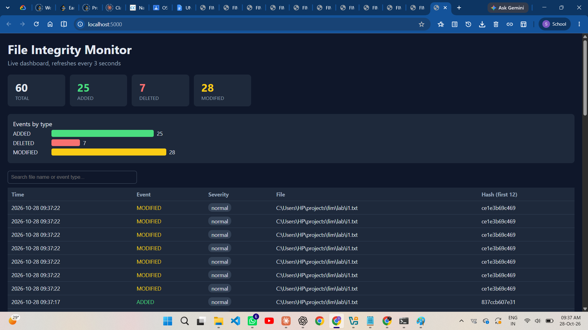
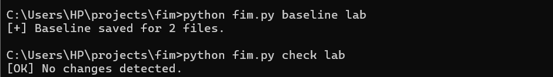
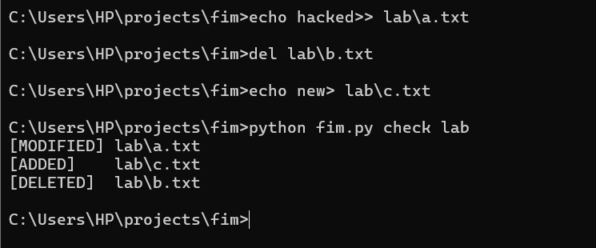
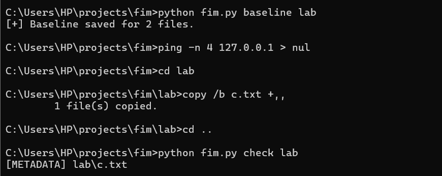
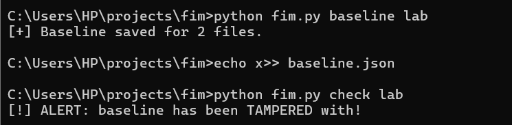
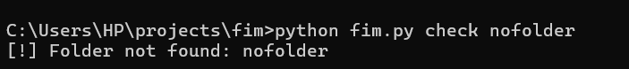
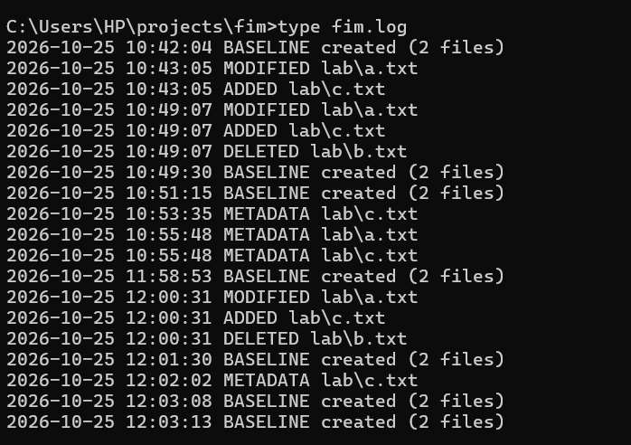

# File Integrity Monitor (FIM)

A host-based file integrity monitoring tool written in Python. It detects modified, added, deleted and moved files in real time, stores every event in a database, alerts on critical folders, flags ransomware-like bursts of changes, and shows everything on a live local web dashboard.

Version 1 is a command-line baseline checker with an HMAC-signed baseline. Version 2 adds always-on monitoring, an event database, desktop alerts, a dashboard and burst detection.

## Features

### Version 2 (real-time monitoring)
- Real-time detection of ADDED, MODIFIED, DELETED and MOVED files using `watchdog`
- Monitors real folders listed in `config.json` (for example Downloads)
- Severity levels per folder (`critical` or `normal`)
- Desktop notification when a file changes in a critical folder
- Burst detection: raises a critical BURST alert when many different files change within a short time (ransomware-like behaviour), with a cooldown to avoid alert spam
- SQLite database that keeps the full event history (time, type, path, SHA-256 hash, severity)
- Live web dashboard: totals, events-by-type chart, searchable event table, auto-refresh every 3 seconds
- Ignore rules for temporary files and folders (`*.tmp`, `*.crdownload`, `.git`, ...)
- One-click start script (`start_fim.bat`)

### Version 1 (baseline checker)
- SHA-256 baseline of every file in a folder
- Detects modified, added and deleted files, plus permission and timestamp-only changes
- HMAC-signed baseline: tampering raises an alert
- Timestamped log file and error handling

## How it works

```
Monitored folders --> Watcher (watchdog) --> SHA-256 hash --> SQLite database --> Flask dashboard
                                   |
                                   +--> Desktop alert (critical folders)
                                   |
                                   +--> Burst detector (many files in a short time) --> BURST alert
```

## Project structure

```
fim/
|-- fim.py            v1 baseline checker (hashing, HMAC-signed baseline, compare)
|-- watcher.py        v2 real-time monitoring and burst detection
|-- config.py         loads config.json and ignore rules
|-- config.json       folders to monitor, severity, ignore patterns, burst settings
|-- database.py       SQLite event storage
|-- alerts.py         desktop notifications
|-- dashboard.py      Flask web dashboard (API)
|-- templates/
|   `-- index.html    dashboard page
|-- start_fim.bat     starts watcher and dashboard
|-- requirements.txt
|-- lab/              sample folder for testing
`-- screenshots/
```

## Requirements
- Python 3
- Windows (the alerts and start script use Windows features)
- Libraries: `watchdog`, `plyer`, `flask`

## Setup

```bat
git clone https://github.com/syphia07-cloud/file-integrity-monitor.git
cd file-integrity-monitor
pip install -r requirements.txt
```

Edit `config.json` to choose the folders you want to monitor and tune burst detection:

```json
{
    "monitored_folders": [
        {"path": "lab", "severity": "normal"},
        {"path": "~/Downloads", "severity": "critical"}
    ],
    "ignore_patterns": ["*.tmp", "*.crdownload", "*.part", "~$*"],
    "ignore_folders": [".git", "__pycache__", "node_modules"],
    "burst_detection": {
        "threshold": 20,
        "window_seconds": 10,
        "cooldown_seconds": 60
    }
}
```

`burst_detection` means: if at least `threshold` different files change within `window_seconds`, raise one BURST alert, then stay quiet for `cooldown_seconds`.

## Usage

### Version 2: real-time monitor and dashboard
Double-click `start_fim.bat`, or run:

```bat
python watcher.py
python dashboard.py
```

Then open http://localhost:5000 in your browser.

To test it, create, edit or delete a file inside a monitored folder. The event appears in the terminal and on the dashboard within a few seconds. Changes in `critical` folders also show a desktop notification.

To test burst detection, create many files quickly in the `lab` folder:

```bat
for /L %i in (1,1,25) do @echo x> lab\burst%i.txt
```

A `[BURST]` line appears in the watcher window, a critical desktop alert is shown, and a BURST event is saved on the dashboard. Delete the test files afterwards with `del lab\burst*.txt`.

### Version 1: baseline check
Set a secret key, create a baseline, then check:

```bat
set FIM_KEY=your-long-random-secret
python fim.py baseline lab
python fim.py check lab
```

## Screenshots

### Dashboard (version 2)


### Baseline and clean check


### Modified, added and deleted files detected


### Metadata change detected


### Tampered baseline alert


### Error handling


### Log file


## What it can detect
- New, changed, deleted and moved files in monitored folders (v2)
- Sudden bursts of file changes that look like ransomware-style activity (v2)
- Content changes, deleted and new files, permission and timestamp changes, and baseline tampering (v1)

## Limitations
- This is a file change monitor, not an antivirus. It tells you what changed, not whether a file is malicious.
- Burst detection is a simple heuristic. Normal bulk actions such as extracting a zip file, copying a folder or running `git clone` can also trigger it, so tune the threshold for your folders.
- The dashboard has no login and listens only on `127.0.0.1`, so only the same computer can open it. Do not expose it to a network.
- The v2 event database is not signed, so someone with access to the machine could edit `fim.db`. The HMAC-signed baseline exists only in v1.
- Monitoring runs only while the watcher is running.
- If an attacker steals the secret key, the v1 baseline signature can be forged.
- Do not monitor system folders such as `C:\Windows`; they change constantly and create noise.

## Possible improvements
- Email alerts and CSV or HTML report export
- HMAC-signed event records in the database
- Dashboard login
- Run the watcher as a Windows background service
- Optional hash lookup against a malware database

## Built with
Python, watchdog, Flask, SQLite, plyer. Developed with AI assistance (Claude); I tested, ran and extended the code.

## Author
Swetha